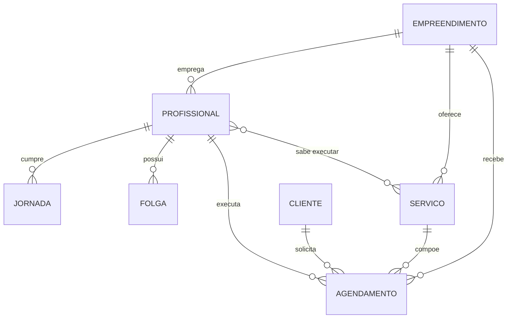

# Modelo de Domínio

> **FDD — Processo 1: Develop an Overall Model**
> Status: rascunho para revisão
> Multi-tenancy e contas de usuário: ver [ADR 0004](adr/0004-multi-tenancy-e-autenticacao.md) ·
> [ADR 0007](adr/0007-profissional-como-conta.md) (profissional também é conta)

---

## 1. Propósito

Estabelecer a linguagem e as estruturas do domínio antes de qualquer código.
Tudo que vier depois — arquitetura, features, telas — deriva daqui.

---

## 2. Requisitos do sistema

### 2.1 Requisitos funcionais

| ID | Requisito |
|---|---|
| RF01 | O sistema deve permitir que clientes e empreendimentos criem uma conta e iniciem e encerrem uma sessão. |
| RF02 | O sistema deve permitir que profissionais iniciem uma sessão com credenciais criadas pelo empreendimento ao cadastrá-los. |
| RF03 | O sistema deve apresentar a cada tipo de conta somente as operações correspondentes ao seu papel: cliente, empreendimento ou profissional. |
| RF04 | O sistema deve permitir que o cliente consulte empreendimentos ativos e pesquise por nome ou cidade. |
| RF05 | O sistema deve permitir que o cliente consulte os dados de um empreendimento e seus serviços e profissionais ativos. |
| RF06 | O sistema deve permitir que o cliente escolha um serviço, um profissional habilitado para executá-lo, uma data e um horário disponível e confirme o agendamento. |
| RF07 | O sistema deve calcular e apresentar os horários disponíveis de um profissional considerando a jornada, as folgas, os agendamentos que ocupam horário e a duração do serviço escolhido. |
| RF08 | O sistema deve permitir que o cliente consulte seus agendamentos realizados em diferentes empreendimentos, separados entre próximos e histórico. |
| RF09 | O sistema deve permitir que o cliente cancele um agendamento futuro ainda agendado. |
| RF10 | O sistema deve permitir que o cliente consulte e atualize o próprio nome e telefone. |
| RF11 | O sistema deve permitir que o empreendimento consulte os profissionais vinculados a ele, incluindo os inativos, e ative ou inative cada profissional. |
| RF12 | O sistema deve permitir que o empreendimento cadastre e edite profissionais, associe a cada profissional os serviços que executa e defina sua jornada inicial. |
| RF13 | O sistema deve permitir que o empreendimento consulte, cadastre e edite seus serviços, bem como ative ou inative cada serviço. |
| RF14 | O sistema deve permitir que o empreendimento consulte a agenda diária consolidada de seus profissionais. |
| RF15 | O sistema deve permitir que o empreendimento registre um agendamento como realizado, falta ou cancelado. |
| RF16 | O sistema deve permitir que cada profissional consulte seus próprios agendamentos nas visões de dia, semana e mês, com a data, o horário e o status de cada agendamento. |
| RF17 | O sistema deve permitir que o profissional consulte e altere a própria jornada semanal. |
| RF18 | O sistema deve permitir que o profissional cadastre e remova as próprias folgas. |
| RF19 | O sistema deve apresentar, para cada profissional e período selecionado, a quantidade de atendimentos realizados e a taxa de ocupação. |

### 2.2 Requisitos não funcionais

| ID | Requisito |
|---|---|
| RNF01 | **Usabilidade:** ao criar, editar, cancelar ou alterar o status de um registro, a interface deve apresentar confirmação de sucesso ou mensagem de falha; campos obrigatórios inválidos devem bloquear o envio e indicar o problema. |
| RNF02 | **Idioma:** todos os textos apresentados na interface ao usuário devem estar em português do Brasil. |
| RNF03 | **Controle de acesso:** operações protegidas devem exigir autenticação; cada conta só pode executar operações autorizadas para seu tipo e acessar dados próprios ou explicitamente compartilhados com ela. |
| RNF04 | **Isolamento entre empreendimentos:** uma conta de empreendimento só pode consultar ou alterar profissionais, serviços, jornadas, folgas e agendamentos pertencentes ao próprio empreendimento. |
| RNF05 | **Persistência:** no sistema integrado, alterações confirmadas em dados cadastrais, profissionais, serviços, jornadas, folgas e agendamentos devem continuar disponíveis após o encerramento e reinício da sessão. |
| RNF06 | **Desempenho:** nas condições de teste documentadas e com conexão estável, as telas principais devem estar prontas para uso em até 3 segundos; interações locais devem responder em até 1 segundo; operações que dependem de serviços externos devem apresentar sucesso ou erro em até 5 segundos. |
| RNF07 | **Disponibilidade e falhas:** o sistema não garante um percentual de disponibilidade dos serviços externos; quando uma dependência estiver indisponível, deve informar a falha e não apresentar como concluída uma operação que não foi confirmada. |

### 2.3 Observações sobre os requisitos

Esta subseção esclarece como interpretar e avaliar os requisitos da seção. Ela não acrescenta
requisitos funcionais nem substitui os critérios definidos nas tabelas.

- **Tipos de requisito:** requisitos funcionais (RF) descrevem serviços e comportamentos que o
    sistema deve oferecer. Requisitos não funcionais (RNF) definem condições de qualidade,
    operação e proteção aplicáveis a esses serviços.
- **Avaliação de desempenho:** os limites do RNF06 devem ser medidos em condições de teste
    documentadas, incluindo dispositivo, navegador e conexão. Para operações externas, mede-se o
    tempo até a interface apresentar sucesso ou erro.
- **Disponibilidade:** o RNF07 especifica o comportamento esperado diante de falhas, não uma
    garantia de uptime. A disponibilidade da hospedagem e dos serviços externos está fora do
    controle do projeto.
- **Acessibilidade:** os requisitos e critérios de conformidade ainda estão pendentes de definição;
    não se presume um padrão ou nível de conformidade nesta versão.

---

## 3. Linguagem ubíqua

Termos do domínio usados de forma consistente em documentação, código e interface.

| Termo | Significado |
|---|---|
| **Conta de acesso** | Identidade autenticada associada a um cliente, empreendimento ou profissional. Credenciais são responsabilidade do mecanismo de autenticação, não atributos cadastrais do domínio. |
| **Empreendimento** | Salão ou barbearia cadastrado na plataforma; tem conta própria e seus funcionários |
| **Profissional** | Funcionário de um empreendimento que executa os serviços (cabeleireiro, manicure, esteticista) |
| **Cliente** | Quem recebe o atendimento; tem conta própria na plataforma e agenda em um ou mais empreendimentos |
| **Serviço** | O que é oferecido, com duração e preço definidos |
| **Agendamento** | Compromisso marcado: um cliente, um profissional, um serviço, uma data/hora |
| **Jornada** | Horário de trabalho recorrente de um profissional em um dia da semana |
| **Folga** | Ausência pontual em uma data específica, que anula a jornada daquele dia |
| **Escala** | Conjunto das jornadas e folgas de um profissional |
| **Disponibilidade** | Os intervalos de tempo em que um profissional pode receber agendamento |
| **Atendimento** | Agendamento que foi efetivamente realizado |

> Nota: *Agendamento* e *Atendimento* **não** são sinônimos. Agendamento é o compromisso;
> atendimento é o agendamento concluído. A distinção importa para as métricas de produtividade
> (RF19).

---

## 4. Entidades

### Empreendimento

| Atributo | Tipo | Obrigatório | Observação |
|---|---|---|---|
| id | identificador | sim | identificador da conta de acesso associada |
| nome | texto | sim | nome do salão/barbearia exibido ao cliente |
| telefone | texto | não | |
| cnpj | texto | sim | identificação do negócio |
| endereco | texto | sim | endereço completo, exibido na tela de detalhes |
| cidade | texto | sim | usada na busca de empreendimentos (RF04) |
| ativo | booleano | sim | inativo não aparece na busca do cliente |

Dono de `Profissional` e `Serviço` — ver "Modelagem no Firestore" em `docs/arquitetura.md` para o
isolamento entre empreendimentos.

### Profissional

| Atributo | Tipo | Obrigatório | Observação |
|---|---|---|---|
| id | identificador | sim | identificador da conta de acesso associada |
| empreendimentoId | referência | sim | empreendimento ao qual o funcionário pertence |
| nome | texto | sim | |
| telefone | texto | não | |
| servicos | lista de Serviço | sim | quais serviços sabe executar (do mesmo empreendimento) |
| ativo | booleano | sim | inativo não aparece para agendamento |

Tem conta própria, mas **não se autocadastra**: o empreendimento cria suas credenciais no cadastro.
Com a conta, o profissional acessa sua própria agenda e ajusta sua jornada e folgas. As credenciais
pertencem à conta de acesso, não aos dados cadastrais do profissional.

### Serviço

| Atributo | Tipo | Obrigatório | Observação |
|---|---|---|---|
| id | identificador | sim | |
| empreendimentoId | referência | sim | empreendimento ao qual o serviço pertence |
| nome | texto | sim | ex.: "Corte feminino" |
| duracaoMinutos | inteiro positivo | sim | base do cálculo de horário |
| preco | decimal | sim | |
| ativo | booleano | sim | |

### Cliente

| Atributo | Tipo | Obrigatório | Observação |
|---|---|---|---|
| id | identificador | sim | identificador da conta de acesso associada |
| nome | texto | sim | |
| telefone | texto | sim | principal forma de contato no setor |
| cpf | texto | sim | identificação da pessoa |

Entidade **global**: a mesma conta de cliente agenda em empreendimentos diferentes, não pertence a
nenhum deles.

### Agendamento

| Atributo | Tipo | Obrigatório | Observação |
|---|---|---|---|
| id | identificador | sim | |
| empreendimentoId | referência | sim | empreendimento em que o agendamento foi feito |
| clienteId | referência | sim | |
| profissionalId | referência | sim | deve pertencer ao mesmo `empreendimentoId` (RN09) |
| servicoId | referência | sim | deve pertencer ao mesmo `empreendimentoId` (RN09) |
| duracaoMinutos | inteiro | sim | duração acordada no momento do agendamento; não acompanha alterações posteriores no serviço |
| inicio | data e hora | sim | |
| fim | data e hora | sim | derivado: `inicio + duracaoMinutos` |
| status | enum | sim | `Agendado` · `Realizado` · `Cancelado` · `Falta` |
| observacao | texto | não | |

> `fim` e `duracaoMinutos` preservam o horário e a duração combinados mesmo que o serviço seja
> alterado depois. Os nomes exibidos no histórico também são cópias do momento da marcação; a
> estratégia de armazenamento dessas cópias é detalhada na arquitetura.

### Jornada

| Atributo | Tipo | Obrigatório | Observação |
|---|---|---|---|
| id | identificador | sim | |
| profissionalId | referência | sim | |
| diaSemana | enum | sim | segunda … domingo |
| horaInicio | hora | sim | |
| horaFim | hora | sim | |

Um profissional tem **uma jornada por dia da semana em que trabalha**. Dia sem jornada = dia não
trabalhado.

Jornada é o conceito do domínio; a representação atual mantém a lista semanal de jornadas dentro
do registro do profissional, em vez de tratá-la como uma coleção independente.

### Folga

| Atributo | Tipo | Obrigatório | Observação |
|---|---|---|---|
| id | identificador | sim | |
| profissionalId | referência | sim | |
| data | data | sim | |
| motivo | texto | não | |

---

## 5. Diagrama de entidades



---

## 6. Regras de negócio

O coração do sistema. São estas regras que separam o app de uma planilha.

| ID | Regra | Origem |
|---|---|---|
| **RN01** | Um agendamento não pode se sobrepor a outro agendamento ativo do mesmo profissional | RF06, RF07 |
| **RN02** | O agendamento deve estar dentro da jornada do profissional naquele dia da semana | RF07 |
| **RN03** | Não é permitido agendar em data de folga do profissional | RF07 |
| **RN04** | O profissional só pode ser agendado para serviços que sabe executar | RF06 |
| **RN05** | O agendamento não pode ultrapassar o fim da jornada do dia | RF07 |
| **RN06** | Não é permitido criar agendamento em data/hora passada | RF06 |
| **RN07** | Agendamento `Cancelado` ou `Falta` libera o horário para novo agendamento | RF07, RF09, RF15 |
| **RN08** | Apenas profissionais e serviços ativos podem ser usados em novos agendamentos | RF06 |
| **RN09** | O profissional e o serviço de um agendamento devem pertencer ao mesmo empreendimento do agendamento | RF06 |
| **RN10** | A duração de um serviço deve ser um número inteiro positivo de minutos | RF13 |
| **RN11** | Um profissional deve estar associado a pelo menos um serviço para ser cadastrado | RF12 |
| **RN12** | Não é permitido cadastrar folga em data passada | RF18 |

**Sobre RN01 — definição de sobreposição.** Dois agendamentos A e B conflitam quando:

```
A.inicio < B.fim   E   B.inicio < A.fim
```

Encostar não é conflito: um agendamento que termina 10:00 e outro que começa 10:00 convivem.
Esta é a regra com mais casos de borda do sistema e será desenvolvida com **teste primeiro**,
conforme a convenção de TDD pontual.

---

## 7. Valores derivados

Não são armazenados — calculados sob demanda.

| Valor | Cálculo | Atende |
|---|---|---|
| **Horários livres** | intervalos da jornada que comportam a duração do serviço, excluídas folgas e sobreposições com agendamentos ativos | RF07 |
| **Atendimentos realizados** | contagem de agendamentos com status `Realizado` no período selecionado | RF19 |
| **Minutos ocupados** | soma da duração registrada nos agendamentos `Realizado` no período | RF19 |
| **Minutos disponíveis** | soma da duração das jornadas no período, excluídos os dias de folga | RF19 |
| **Taxa de ocupação** | minutos ocupados ÷ minutos disponíveis; se não houver minutos disponíveis, o resultado é zero | RF19 |

A **taxa de ocupação** é a métrica central do trabalho: é ela que traduz *"produtividade
individual"* em número comparável entre profissionais com jornadas diferentes.

---

## 8. Premissas de escopo

Decisões tomadas para manter o projeto enxuto. Registradas para que o limite do escopo fique
explícito e não seja reaberto por engano no meio do desenvolvimento.

| # | Premissa | Justificativa |
|---|---|---|
| ~~P1~~ | ~~Salão único. Não há entidade `Salão` nem multi-tenant~~ | **Revisada pelo ADR 0004** — a plataforma passou a atender múltiplos empreendimentos |
| ~~P2~~ | ~~Sem autenticação por perfil. Uso administrativo interno~~ | **Revisada pelo ADR 0004 e estendida pelo ADR 0007** — cliente, empreendimento e profissional têm contas autenticadas |
| ~~P3~~ | ~~Cliente não acessa o sistema. Quem agenda é o salão~~ | **Revisada pelo ADR 0004** — o cliente tem conta própria e agenda diretamente |
| P4 | **Sem controle financeiro.** `preco` existe apenas como dado do serviço | Fora do escopo|
| P5 | **Sem notificações** (e-mail, SMS, WhatsApp) | Dependência externa desnecessária ao objetivo |
| ~~P6~~ | ~~Linguagem do domínio em português no código~~ | **Revisada pelo [ADR 0005](adr/0005-idioma-do-codigo.md)** — código em inglês, documentação e texto de tela continuam em português |
| P7 | **Sem Custom Claims / Cloud Functions.** O tipo de conta (cliente, empreendimento ou profissional) é resolvido lendo `users/{uid}` no Firestore, não no token de autenticação | Evita reintroduzir backend — coerente com o ADR 0002. Ver ADR 0004 e ADR 0007 |

---

## 9. Questões em aberto

| # | Questão | Impacto |
|---|---|---|
| Q1 | Serviço pode ter duração variável por profissional? | Se sim, muda a determinação da duração acordada e a relação Profissional↔Serviço |
| Q2 | Precisa de intervalo entre atendimentos (limpeza/descanso)? | Se sim, entra como regra na RN01 |
